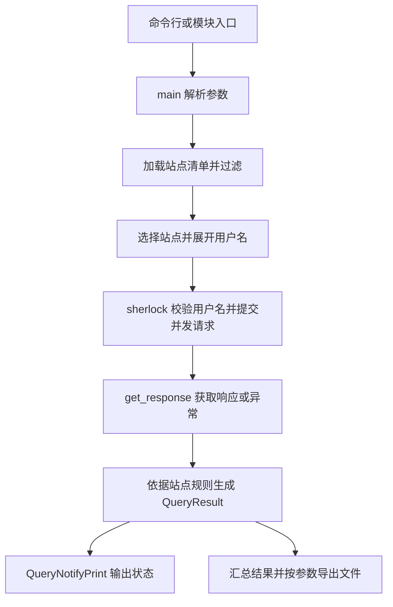

# Sherlock 中文说明

Sherlock 是一个基于 Python 的命令行工具，用于按用户名查找社交平台、社区和其他网站上的公开账号页面。站点规则由 JSON 文件维护，程序通过并发 HTTP 请求和预设规则判断用户名是否存在。

[English README](docs/README.md) · [站点配置](sherlock_project/resources/data.json) · [许可证](LICENSE)

本文面向当前仓库的使用者和开发者，采用 uv 管理本地环境。项目版本、Python 要求和依赖声明以 [pyproject.toml](pyproject.toml) 为准。

## 功能概览

| 功能 | 说明 |
| --- | --- |
| 多站点查询 | 仓库内置 400 多个站点的检测规则，可一次查询全部候选站点或指定站点 |
| 多用户名查询 | 支持多个用户名，并将 `name{?}suffix` 展开为下划线、连字符和点号三种形式 |
| 并发请求 | 使用线程池并发探测同一用户名在不同站点的页面，当前上限为 20 个工作线程 |
| 多种判定策略 | 根据 HTTP 状态码、页面中的错误提示或重定向响应判断账号是否存在 |
| 网络与诊断 | 支持 HTTP/SOCKS 代理、请求超时、响应耗时和原始响应输出 |
| 结果展示与导出 | 支持彩色终端输出、浏览器打开命中页面，以及 TXT、CSV、XLSX 导出 |
| 可维护的站点清单 | 支持远程清单、本地清单、自定义 JSON 文件，以及上游误报排除列表 |
| 结果状态区分 | 区分发现账号、未发现账号、未知错误、非法用户名和 WAF 拦截 |

检测命中表示站点响应符合当前规则；同名账号是否属于同一个人，需要结合页面内容判断。站点改版、登录限制和反爬机制也可能影响检测结果。

## 快速开始

### 环境要求

- Python `>=3.10,<4.0`。
- 已安装 uv；可参考 [uv 安装文档](https://docs.astral.sh/uv/getting-started/installation/)。
- 在仓库根目录执行下面的命令。

### 安装与运行

```bash
# 安装项目和默认的开发依赖，创建或更新 .venv
uv sync --locked

# 查看命令帮助和版本
uv run --locked sherlock --help
uv run --locked sherlock --version

# 查询单个用户名或多个用户名
uv run --locked sherlock user123
uv run --locked sherlock user123 user456
```

无需手动激活虚拟环境。也可以通过模块入口启动：

```bash
uv run --locked python -m sherlock_project --help
```

只安装运行依赖时，运行命令也应带上 `--no-dev`，避免再次同步默认开发依赖：

```bash
uv sync --locked --no-dev
uv run --locked --no-dev sherlock user123
```

安装所有依赖组，包括 CI 结果汇总工具：

```bash
uv sync --locked --all-groups
```

## 使用示例

```bash
# 使用仓库内置清单，仅查询指定站点
uv run --locked sherlock user123 --local --site GitHub --site GitLab

# 查询用户名变体：user_name、user-name、user.name
uv run --locked sherlock 'user{?}name'

# 将命中链接写入指定 TXT 文件
uv run --locked sherlock user123 --txt --output user123.txt

# 将多个用户名的 TXT 和 CSV 结果写入指定目录
uv run --locked sherlock user123 user456 --txt --csv --folderoutput results

# 将包含未命中结果的完整报告写入 XLSX
uv run --locked sherlock user123 --xlsx --print-all

# 通过本机已有的 SOCKS 代理发起探测
uv run --locked sherlock user123 --proxy socks5://127.0.0.1:1080 --timeout 20

# 使用指定清单调试某个站点
uv run --locked sherlock user123 --json sherlock_project/resources/data.json \
  --site GitHub --verbose --dump-response
```

### 常用参数

| 参数 | 用途 |
| --- | --- |
| `--site SITE_NAME` | 限定站点，可重复传入；站点名查询不区分大小写 |
| `--local` | 使用包内 `resources/data.json`，并跳过上游排除列表 |
| `--json JSON_FILE` | 使用本地 JSON、远程 JSON URL 或上游 Pull Request 编号中的站点清单 |
| `--timeout SECONDS` | 设置单次探测请求的超时，默认 60 秒 |
| `--proxy PROXY_URL` | 为站点探测请求指定代理 |
| `--txt` / `--csv` / `--xlsx` | 启用对应格式的结果文件 |
| `--output FILE` | 指定单个用户名的 TXT 路径，需同时使用 `--txt` |
| `--folderoutput DIR` | 指定 TXT、CSV 输出目录，与 `--output` 互斥 |
| `--print-all` | 展示未命中和错误结果，并在 CSV、XLSX 中保留这些结果 |
| `--verbose` / `--dump-response` | 显示耗时信息 / 输出探测响应，便于排查规则 |
| `--browse` / `--no-color` | 在浏览器打开命中页面 / 关闭终端颜色 |
| `--nsfw` | 将默认过滤的成人站点也纳入查询；显式指定站点时存在保留例外 |
| `--ignore-exclusions` | 忽略上游误报排除列表，适合检查被排除的站点 |

默认只向终端展示命中结果，不创建 TXT 文件。启用 `--txt` 后，每个用户名对应一个文本文件，内容为命中链接和数量；CSV、XLSX 默认也只导出命中结果，配合 `--print-all` 可保留其他状态。当前 XLSX 文件固定写入工作目录中的 `<用户名>.xlsx`，不使用 `--folderoutput`。

默认运行会读取远程站点清单并尝试应用上游排除列表。`--local` 只改变站点清单的来源，仍会请求目标网站；命令启动时也会尝试检查新版本。`--proxy` 当前只用于站点探测，版本检查和清单下载不通过这个参数设置代理。

## 技术栈

| 层次 | 技术 | 在项目中的用途 |
| --- | --- | --- |
| 语言与入口 | Python、`argparse` | 命令行解析、参数校验和执行流程 |
| 网络访问 | `requests`、`requests-futures` | HTTP 会话、线程池并发和 Future 结果处理 |
| 网络支持 | `PySocks`、`certifi` | SOCKS 代理支持和 CA 证书依赖 |
| 终端展示 | `colorama` | 跨平台彩色状态输出 |
| 数据导出 | 标准库 `csv`、`pandas`、`openpyxl` | CSV 和 Excel 报告 |
| 配置与数据 | JSON、JSON Schema、`tomli` | 站点规则、规则结构校验、源码运行时的版本读取 |
| 依赖与构建 | uv、`uv.lock`、`poetry-core` | 环境管理、依赖锁定和 Python 包构建 |
| 测试 | `pytest`、`pytest-xdist`、`jsonschema`、`rstr` | 回归测试、并行站点检测、清单校验和随机用户名生成 |
| 开发检查 | tox、Ruff、coverage | 多环境测试、静态检查和覆盖率统计 |
| 自动化 | GitHub Actions、`defusedxml` | 回归测试、站点规则验证、JUnit XML 结果汇总 |

项目采用 Python 包和命令行模块组织代码，主要扩展点是站点规则、查询结果对象和通知接口。

## 框架与目录结构

```text
sherlock/
├── README.md                        # 中文使用和开发说明
├── pyproject.toml                   # 包元数据、命令入口、依赖与构建配置
├── uv.lock                          # 锁定运行和开发依赖
├── sherlock_project/
│   ├── __init__.py                   # 包信息与版本读取
│   ├── __main__.py                   # python -m sherlock_project 入口
│   ├── sherlock.py                   # CLI、并发请求、判定和结果导出
│   ├── sites.py                      # 站点清单加载、排除和 NSFW 过滤
│   ├── result.py                     # QueryStatus、QueryResult
│   ├── notify.py                     # 查询通知接口与终端输出实现
│   ├── py.typed                      # 类型信息标记
│   └── resources/
│       ├── data.json                 # 内置站点清单
│       └── data.schema.json          # 站点规则的 JSON Schema
├── tests/                           # 清单、CLI、编码、版本和在线检测测试
├── devel/
│   ├── site-list.py                  # 生成站点文档并排序站点配置
│   └── summarize_site_validation.py  # 将 JUnit XML 汇总为 Markdown
├── docs/
│   ├── README.md                    # 英文 README
│   ├── pyproject/README.md          # PyPI 包说明
│   └── CODE_OF_CONDUCT.md           # 社区行为准则
├── .github/workflows/               # 回归、站点验证和清单更新工作流
├── .actor/                          # Apify Actor 部署集成
├── Dockerfile                       # 已发布版本的容器安装配置
├── pytest.ini                       # 测试标记和默认选择规则
├── tox.ini                          # 测试环境与 Ruff 检查配置
└── .editorconfig                    # 编辑器格式约定
```

### 执行流程



入口命令 `sherlock` 在 `[project.scripts]` 中映射到 `sherlock_project.sherlock:main`。`SitesInformation` 负责提供站点数据，`sherlock()` 负责一次用户名查询；多个用户名依次处理，每个用户名内部的站点请求并发执行。需要自定义结果通知时，可以继承 `QueryNotify`，实现 `start()`、`update()` 和 `finish()`。

### 结果状态

| 状态 | 含义 |
| --- | --- |
| `CLAIMED` | 检测到该用户名 |
| `AVAILABLE` | 按当前规则未检测到该用户名 |
| `UNKNOWN` | 请求、编码或规则处理发生错误，无法确定 |
| `ILLEGAL` | 用户名不符合该站点的正则约束 |
| `WAF` | 响应命中已知的反爬或防火墙拦截特征 |

`QueryResult` 同时记录用户名、站点名、用户页面 URL、请求耗时和可选的上下文信息。

## 开发规范

### 代码与配置

- 格式遵循 [.editorconfig](.editorconfig)：UTF-8、LF 换行、文件末尾换行；Python 使用 4 个空格缩进，其他文件默认使用 2 个空格。
- Python 字符串按编辑器约定使用双引号，修改时保持周围代码风格，避免无关的大范围格式调整。
- 新增功能优先复用站点数据、结果对象和通知接口；站点特有的 URL、请求头、请求方式和匹配规则尽量放在 JSON 清单中。
- 修改查询或错误处理逻辑时，增加能覆盖具体行为的回归测试；普通单元测试优先使用本地数据或替代网络响应。
- 版本号维护在 `pyproject.toml` 的 `[project].version` 中；运行时优先读取安装元数据，缺失时从该字段读取，避免在模块中重复硬编码版本号。

### 依赖管理

依赖声明分为三个位置：

| 配置 | 内容 |
| --- | --- |
| `[project].dependencies` | 用户运行 Sherlock 所需的依赖 |
| `[dependency-groups].dev` | 默认安装的测试和开发依赖 |
| `[dependency-groups].ci` | CI 结果汇总工具，按需安装 |

修改依赖声明后，更新并提交锁文件：

```bash
uv lock
uv sync --locked --all-groups
```

将 `pyproject.toml` 和 `uv.lock` 一起提交，不手工修改锁文件中的版本、哈希或下载地址。`.venv`、构建产物和查询结果文件不应纳入提交。uv 负责环境与依赖管理，包构建后端仍为 `poetry-core`。

### 测试与静态检查

日常回归可先排除在线探测和全站点验证：

```bash
uv run --locked pytest -q -m "not online and not validate_targets"
```

这组选项会排除社交站点探测测试，但部分 fixture 仍会尝试获取上游排除列表，失败后继续执行，因此不是严格断网测试。

测试标记在 [pytest.ini](pytest.ini) 中注册：

| 标记 | 用途 |
| --- | --- |
| `online` | 需要访问远程站点或远程 Schema 的测试 |
| `validate_targets` | 遍历站点的准确性验证，默认排除 |
| `validate_targets_fp` | 使用随机用户名检测误报 |
| `validate_targets_fn` | 使用已知存在的用户名检测漏报 |

静态检查和指定 Python 版本的测试通过现有 tox 配置执行：

```bash
uvx tox -e lint
uvx tox -e py313
```

tox 和 Ruff 由工具环境安装，不在当前 uv 开发依赖组中。`py313` 环境需要本机有 Python 3.13；其他已配置的测试环境包括 `py310`、`py311`、`py312`，这些测试环境会运行默认测试集并生成覆盖率统计，其中包含在线测试。

### 新增或修复站点

1. 编辑 [data.json](sherlock_project/resources/data.json)，参考相近站点的配置，并保持站点键名排序及 2 空格缩进。
2. 为站点填写 `url`、`urlMain`、`errorType` 和已知存在的 `username_claimed`；用户名占位符使用 `{}`。
3. 根据检测策略补充字段：`message` 需要 `errorMsg`，`response_url` 需要 `errorUrl`；`status_code` 可配置 `errorCode`。其他可用字段以 [data.schema.json](sherlock_project/resources/data.schema.json) 为准。
4. 先校验清单，再针对修改的站点运行误报与漏报测试。

```bash
# 校验本地清单结构
uv run --locked pytest tests/test_manifest.py::test_validate_manifest_against_local_schema

# 在线验证指定站点；将 GitHub 替换为修改的站点名，多个名称用逗号分隔
uv run --locked pytest -m validate_targets --chunked-sites "GitHub" -n 2
```

判定策略应与实际响应对应：`message` 查找账号不存在时的文本，`status_code` 检查 HTTP 状态，`response_url` 在单一策略模式下关闭重定向并按响应状态判定。检查规则时同时使用存在和不存在的用户名，保留复现信息，避免只根据一个成功样本判断规则有效。

`devel/site-list.py` 会生成 `output/sites.mdx` 并重写排序后的 `data.json`；它要求 `output` 目录尚不存在，执行后应检查文件差异。

### 提交与协作

提交前运行与改动相关的测试，使用 `git diff --check` 检查空白问题。提交说明应描述具体行为变化；Pull Request 中说明问题、修改内容、验证方式以及站点可达性等影响验证的条件。

打包、测试配置和相关目录的责任人见 [.github/CODEOWNERS](.github/CODEOWNERS)，社区协作约定见 [行为准则](docs/CODE_OF_CONDUCT.md)。

## 构建与自动化

构建源码包和 wheel：

```bash
uv build
```

产物位于 `dist/`。包描述使用 `docs/pyproject/README.md`，站点 JSON 等资源随 `sherlock_project` 一起打包。

| 工作流 | 职责 |
| --- | --- |
| [regression.yml](.github/workflows/regression.yml) | Ruff 检查、跨平台 Python 测试和 Docker 构建检查 |
| [validate_modified_targets.yml](.github/workflows/validate_modified_targets.yml) | 校验 Pull Request 修改的站点配置和检测准确性 |
| [exclusions.yml](.github/workflows/exclusions.yml) | 定期检测误报并维护上游排除列表 |
| [update-site-list.yml](.github/workflows/update-site-list.yml) | 生成站点列表并更新文档仓库 |

本地开发使用 uv；现有 GitHub Actions 中仍有 Poetry 和 tox 命令，具体执行方式以工作流文件为准。根目录 `Dockerfile` 从包索引安装 `VERSION_TAG` 指定的已发布版本，不会复制本地源码；验证本地修改应使用 uv 环境或本地构建的 wheel。Apify 部署集成位于 [.actor](.actor/README.md)。

## 常见问题

| 问题 | 处理方式 |
| --- | --- |
| 查询后没有 TXT 文件 | 增加 `--txt`；仅设置 `--output` 不会启用文件导出 |
| 修改站点 JSON 后结果未变化 | 使用 `--local` 或通过 `--json` 指定修改后的清单 |
| 使用 `--local` 仍发生网络访问 | 该参数控制清单来源，目标网站探测和版本检查仍会联网 |
| 站点查询超时或显示 `WAF` | 使用 `--site` 缩小范围，并结合 `--verbose --dump-response` 检查具体响应 |
| `uv sync --locked` 提示锁文件不一致 | 确认依赖声明的修改后执行 `uv lock`，同步提交配置和锁文件 |

## 许可证

项目使用 [MIT License](LICENSE)。原项目由 Siddharth Dushantha 创建，并由 Sherlock Project 社区维护。
